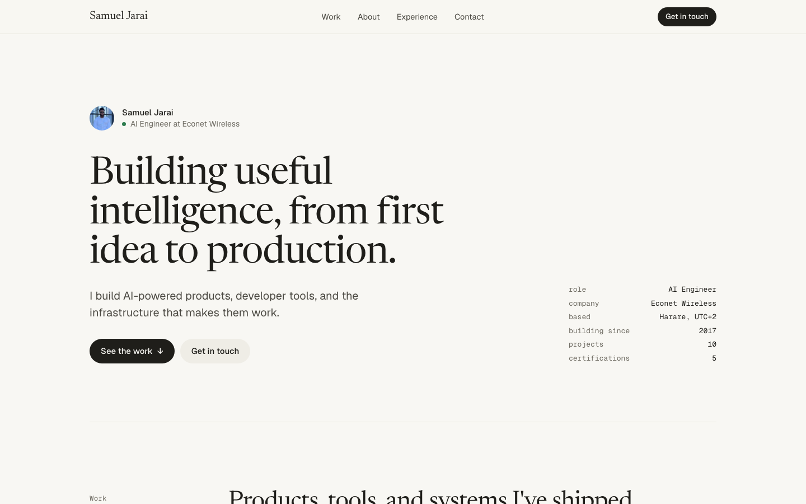
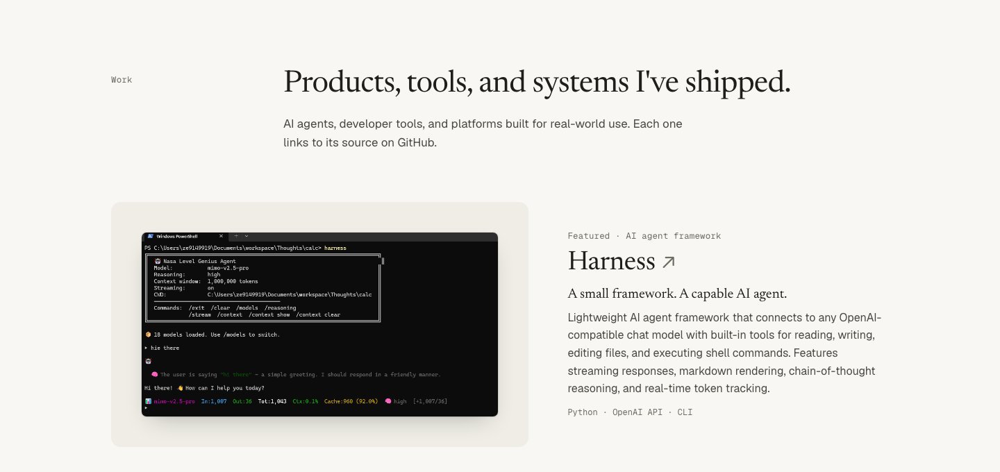

# Samuel Jarai · Portfolio

The source for [samuel.co.zw](https://samuel.co.zw/): a light, minimal, single-page portfolio covering selected work, background, experience, and contact details.

[](https://samuel.co.zw/)



## Overview

- **One page, five sections.** Hero, work, about, experience, and contact, linked by plain in-page anchors (`#work`, `#about`, `#experience`, `#contact`).
- **Content separate from layout.** Projects, roles, awards, certifications, and contact details live in one typed data file.
- **Small footprint.** Vue is the only runtime dependency. There is no router, no animation library, and almost no JavaScript beyond rendering.
- **Accessible by default.** Semantic landmarks, a skip link, visible focus states, and smooth scrolling only for visitors who haven't asked for reduced motion.
- **Responsive.** The layout goes from a three-column project grid on desktop to a single column on phones.

## Tech stack

| Area | Choice |
| --- | --- |
| Framework | Vue 3 (`<script setup>`) with TypeScript |
| Build | Vite |
| Styling | Hand-written CSS with design tokens; Tailwind supplies the base reset and utilities |
| Type | Newsreader (headings), Geist (body), Geist Mono (labels), from Google Fonts |
| Images | Resized and compressed at build time with `sharp` |
| Hosting | GitHub Pages, deployed by GitHub Actions |

## Getting started

Requires Node.js 20 or newer.

```bash
git clone https://github.com/jaggerjack61/portfolio.git
cd portfolio
npm install
npm run dev
```

The dev server prints its local URL, usually `http://localhost:5173`.

| Script | What it does |
| --- | --- |
| `npm run dev` | Start the dev server with hot reload |
| `npm run build` | Type-check, build to `dist/`, and optimise images |
| `npm run preview` | Serve the production build locally |
| `npm run check` | Type-check only |
| `npm run lint` | Lint `.ts` and `.vue` files |
| `npm run lint:fix` | Lint and auto-fix |

## Project structure

```text
├── index.html                 Page shell, meta tags, fonts, structured data
├── public/
│   ├── images/projects/       Project screenshots
│   ├── images/badges/         Certification badges
│   └── images/profile_pic.png
├── src/
│   ├── App.vue                Page composition and footer
│   ├── data/portfolio.ts      All portfolio content
│   ├── components/
│   │   ├── SiteHeader.vue     Sticky navigation
│   │   └── sections/          Hero, Work, About, Experience, Contact
│   └── style.css              Design tokens and all styles
├── docs/                      Screenshots used in this README
└── vite.config.ts             Build config and the image optimiser
```

## Editing content

Almost everything on the page comes from [`src/data/portfolio.ts`](src/data/portfolio.ts).

| To change | Edit |
| --- | --- |
| Projects | `projects`, plus a matching entry in `categories` |
| Roles and dates | `experiences` |
| Awards | `awards` |
| Certifications | `certifications` |
| Focus areas and stack | `focusAreas`, `coreStack` |
| Contact details | `email`, `phone`, `github`, `linkedin` |

A few pieces of copy are written directly in the section components: the hero headline in `HeroSection.vue`, the about paragraphs and education in `AboutSection.vue`, and the section headings.

### Adding a project

1. Put a screenshot in `public/images/projects/`. Any aspect ratio works; screenshots are shown uncropped.
2. Add an entry to `projects`:

   ```ts
   {
     title: 'My Project',
     desc: 'What it does and who it is for.',
     tech: ['Python', 'Django'],
     link: 'https://github.com/jaggerjack61/my-project',
     imageSrc: 'images/projects/my-project.png',
     imageAlt: 'A short description of the screenshot',
   }
   ```

3. Add its label to `categories`, keyed by the same title.

The project count in the hero updates on its own. The featured project is whichever one `orderedProjects` sorts first (currently Harness); its tagline is in `WorkSection.vue`.

### Adding a certification

Put the badge in `public/images/badges/` and add an entry with `title`, `issuer`, and `badge` to `certifications`.

## Design

Colours, fonts, and spacing are CSS custom properties at the top of [`src/style.css`](src/style.css):

| Token | Value | Used for |
| --- | --- | --- |
| `--paper` | `#f8f7f3` | Page background |
| `--panel` | `#efede6` | Screenshot panels, quiet buttons |
| `--ink` | `#1f1e1a` | Text, primary buttons |
| `--ink-soft` | `#4a4841` | Body copy |
| `--ink-mute` | `#6f6c63` | Labels and metadata |
| `--rule` | `#e3e0d6` | Hairline dividers |

Change a token and the whole page follows. Fonts are loaded in `index.html`; if you swap one, update the matching `--font-*` token.

## Deployment

Every push to `main` runs [`.github/workflows/deploy.yml`](.github/workflows/deploy.yml), which lints, type-checks, and builds the site, then publishes `dist/` to the `production` branch that GitHub Pages serves.

During the build, screenshots are resized to at most 1200px wide and badges to 128px, and each file is kept only if the result is smaller than the original. Asset paths are relative, so the build works on a custom domain or under a subpath.

## License

[MIT](LICENSE)
